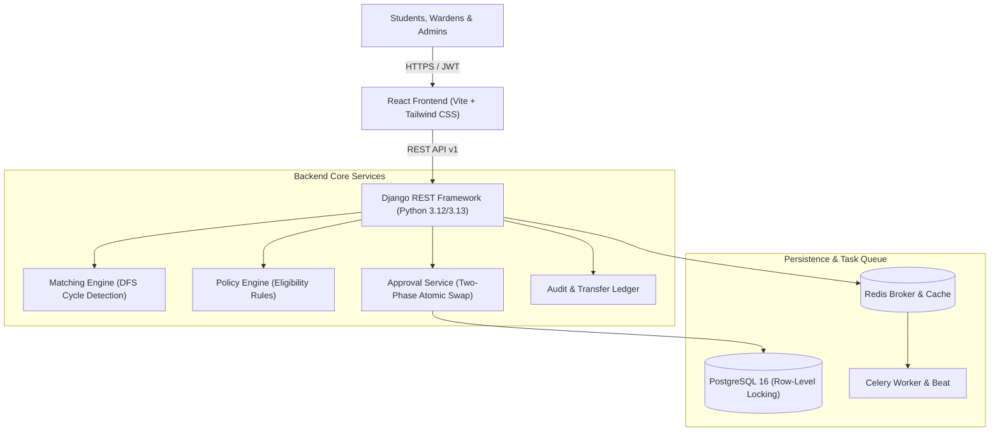

# Hostel Room Exchange and Multi-Party Swap Platform (HostelSwap)

A full-stack institutional web platform for managing hostel bed exchanges, mutual swaps, and multi-party room rotations. Built with **Django REST Framework**, **PostgreSQL 16**, and **React (Vite + Tailwind CSS)**.

---

## Overview & Key Innovations

Traditional college hostel swap mechanisms rely on manual paperwork or basic 1-to-1 mutual exchanges. When student preferences form non-trivial circular dependencies (e.g. Student A wants Room B, Student B wants Room C, and Student C wants Room A), manual reconciliation collapses.

**HostelSwap** solves this with an algorithmic graph engine and transactionally safe execution:

1. **Multi-Party Cycle Detection (Graph Engine)**:
   - Identifies directed simple cycles of length $2 \le N \le 5$ using Depth-First Search (DFS) with canonical cycle deduplication.
   - Automatically prunes edges for gender restrictions, fee dues, disciplinary holds, and unavailable beds prior to running cycle detection.
   - Enables 3-way, 4-way, and 5-way circular room rotations that traditional pairwise swaps cannot discover.

2. **ACID Transaction Correctness & Two-Phase Execution**:
   - Employs PostgreSQL `SELECT FOR UPDATE` row-level locks sorted in ascending primary-key order to guarantee deadlock-free execution under concurrent traffic.
   - **Two-Phase Occupancy Reallocation**: Phase 1 deallocates all participants' previous beds simultaneously; Phase 2 assigns all target beds. This eliminates transient unique constraint collisions.
   - Comprehensive rollback testing: Any mid-transaction exception guarantees 100% database rollback with zero occupancy corruption.

3. **Role-Based Portals & Governance Hierarchy**:
   - **Student Resident**: View current allocation, verify pre-flight policy eligibility, submit swap preferences, and review/accept incoming rotation proposals.
   - **Hostel Warden**: Review consensus-approved proposals within assigned hostels and 1-click execute atomic occupancy swaps.
   - **Chief Warden**: Universal institutional jurisdiction for cross-hostel rotations.
   - **Hostel Administrator**: Configure swap policies, trigger batch matching cycles, inspect audit logs, and manage resident authorizations.
   - **Dean of Student Welfare**: High-level occupancy analytics, capacity benchmarks, and transfer reporting.

---

## System Architecture



---

## Tech Stack

| Layer | Technologies |
| :--- | :--- |
| **Frontend** | React 18, Vite 5, React Router DOM v6, Tailwind CSS v3, Axios, Lucide React, Recharts |
| **Backend** | Python 3.12 / 3.13, Django 5.2, Django REST Framework 3.15, drf-spectacular (OpenAPI 3.0), django-cors-headers, django-filter |
| **Database** | PostgreSQL 16 (ACID transactions, `SELECT FOR UPDATE` row locks) |
| **Cache & Tasks** | Redis 7, Celery 5.4, django-celery-beat |
| **Testing & Quality** | Pytest, pytest-django, Vitest, React Testing Library, ESLint 9 |
| **Containerization** | Docker, Docker Compose |

---

## Project Structure

```text
Hostel-Room-Swap/
├── .github/                      # GitHub Actions workflows & issue templates
│   ├── ISSUE_TEMPLATE/           # Bug report and feature request templates
│   ├── workflows/ci.yml          # Automated CI pipeline (test, lint, build)
│   └── PULL_REQUEST_TEMPLATE.md  # Standardized PR checklist
├── backend/                      # Django backend application
│   ├── apps/
│   │   ├── accounts/             # Authentication, custom User model, OTP & RBAC
│   │   ├── analytics/            # Executive KPI & occupancy aggregations
│   │   ├── approvals/            # Warden approval workflow & two-phase atomic swap
│   │   ├── audit/                # Immutable audit logging ledger
│   │   ├── exchange_requests/    # Resident swap request submission & withdrawal
│   │   ├── hostels/              # Hostels, blocks, rooms, beds, and allocations
│   │   ├── integrations/         # Institutional ERP & P03 occupancy adapters
│   │   ├── matching/             # Graph-based DFS cycle detection engine
│   │   ├── notifications/        # In-app notifications & email dispatch
│   │   ├── policies/             # Cooling-off, fee clearance, & eligibility policies
│   │   ├── proposals/            # Multi-party swap proposals & participant consent
│   │   └── transfers/            # Completed historical transfer records
│   ├── config/                   # Django settings, WSGI, ASGI, Celery, and URLs
│   ├── tests/                    # Pytest test suite (unit, scenario, concurrency)
│   ├── manage.py
│   └── requirements.txt
├── frontend/                     # React Single Page Application (Vite + Tailwind)
│   ├── src/
│   │   ├── components/           # Layout shells, role navigations, modals, widgets
│   │   ├── context/              # AuthContext & session state
│   │   ├── pages/                # Student, Warden, Admin, Dean dashboards & public pages
│   │   ├── services/             # Axios API client with JWT interceptor & endpoints
│   │   └── index.css             # Tailwind directives & high-contrast selection rules
│   ├── package.json
│   └── vite.config.js
├── docs/                         # Architecture, LLD, and system design specifications
├── docker-compose.yml            # Multi-container orchestration (DB, Redis, Backend, Frontend)
├── .env.example                  # Environment configuration template
├── CONTRIBUTING.md               # Contribution guidelines & development setup
├── CODE_OF_CONDUCT.md           # Community code of conduct
└── SECURITY.md                  # Coordinated vulnerability disclosure policy
```

---

## Local Development Setup

### Prerequisites
- Python 3.12 or 3.13
- Node.js 20+ and npm
- PostgreSQL 16 (running on port `5433` or `5432`)
- Redis (optional for basic local testing; mandatory for background Celery tasks)

### 1. Backend Setup

```bash
# 1. Activate virtual environment
# Windows:
.venv\Scripts\activate
# Linux/macOS:
source .venv/bin/activate

# 2. Configure environment variables
# Copy .env.example to backend/.env and update your database credentials
cp .env.example backend/.env

# 3. Apply database migrations
python backend/manage.py migrate

# 4. (Optional) Seed demo hostels, rooms, and resident personas
python backend/manage.py seed_demo_data

# 5. Start development server
python backend/manage.py runserver 8000
```

### 2. Frontend Setup

```bash
cd frontend

# Install dependencies
npm install

# Start Vite dev server (proxies /api to port 8000)
npm run dev
```

Visit `http://localhost:3000` in your browser.

---

## Docker Compose Setup

Run the full containerized stack (PostgreSQL, Redis, Celery, Django, React/Nginx):

```bash
# Copy and adjust environment variables if needed
cp .env.example .env

# Build and start all services
docker compose up --build
```

- **Frontend Application**: `http://localhost:3000`
- **Django REST API**: `http://localhost:8000`
- **Interactive Swagger Docs**: `http://localhost:8000/api/docs/`
- **PostgreSQL**: Bound to `127.0.0.1:5432`

---

## Testing & Quality Assurance

Both backend and frontend test suites are automated and reproducible.

### Backend Tests (Pytest)
```bash
pytest backend/tests backend/apps/accounts -v
```
*Current test suite: **78 passing tests** covering multi-party DFS cycles, atomic row-locking, cross-hostel authority boundaries, gender segregation, and transaction rollback.*

### Django Health & Migration Checks
```bash
python backend/manage.py check
python backend/manage.py makemigrations --check --dry-run
```

### Frontend Tests & Linting
```bash
# Run unit tests (Vitest)
npm --prefix frontend test

# Run ESLint (ESLint 9)
npm --prefix frontend run lint

# Verify production bundle build
npm --prefix frontend run build
```

---

## Demo Personas

When running in development with demo mode enabled (`VITE_ENABLE_DEMO=true`), pre-seeded test personas are available for exploring role-based permissions:

| Persona | Role | Sample Identifier | Responsibilities |
| :--- | :--- | :--- | :--- |
| **Student 1** | `STUDENT` | `student1@hostel.edu` | Submits swap request, reviews proposals |
| **Student 2** | `STUDENT` | `student2@hostel.edu` | Participant in direct and circular swaps |
| **Warden (BH1)** | `WARDEN` | `warden.bh1@hostel.edu` | Approves same-hostel swaps for Boys Hostel 1 |
| **Chief Warden** | `CHIEF_WARDEN` | `chiefwarden@hostel.edu` | Approves cross-hostel multi-party swaps |
| **Hostel Admin** | `HOSTEL_ADMIN` | `admin@hostel.edu` | Configures policies, monitors audit logs |
| **Dean** | `DEAN` | `dean@hostel.edu` | Views capacity analytics and transfer reports |


> [!NOTE]
> **Safe Authentication & Local Testing Instructions**:
> 1. **No Static Public Passwords**: Default or static passwords are not published in public repository files.
> 2. **Ephemeral Local Credentials**: Running `python backend/manage.py seed_demo_data` in development creates local test personas and outputs their ephemeral login credentials directly to your local terminal only.
> 3. **Creating Administrator Accounts**: To create a custom administrative user with an isolated strong password:
>    ```bash
>    python backend/manage.py createsuperuser
>    ```
> 4. **Production Restriction**: The `seed_demo_data` command and `VITE_ENABLE_DEMO=true` flag must never be deployed or executed on staging or production clusters.

---

## Community & Contributing

We welcome community feedback, issue reports, and pull requests!
- Please read our [Contributing Guide](CONTRIBUTING.md) for details on code style, branch workflows, and PR standards.
- View our community standards in the [Code of Conduct](CODE_OF_CONDUCT.md).
- To report security vulnerabilities, review our [Security Policy](SECURITY.md).

---

## Licensing & Institutional Attribution

This platform was originally conceptualized and created as an academic/institutional engineering project for hostel room exchange and multi-party rotation management.

> **Note on License**: Formal open-source licensing (such as MIT, Apache 2.0, or AGPLv3) is pending explicit authorization and confirmation by the project author and institutional stakeholders. Unauthorized re-licensing without institutional compliance is prohibited.
