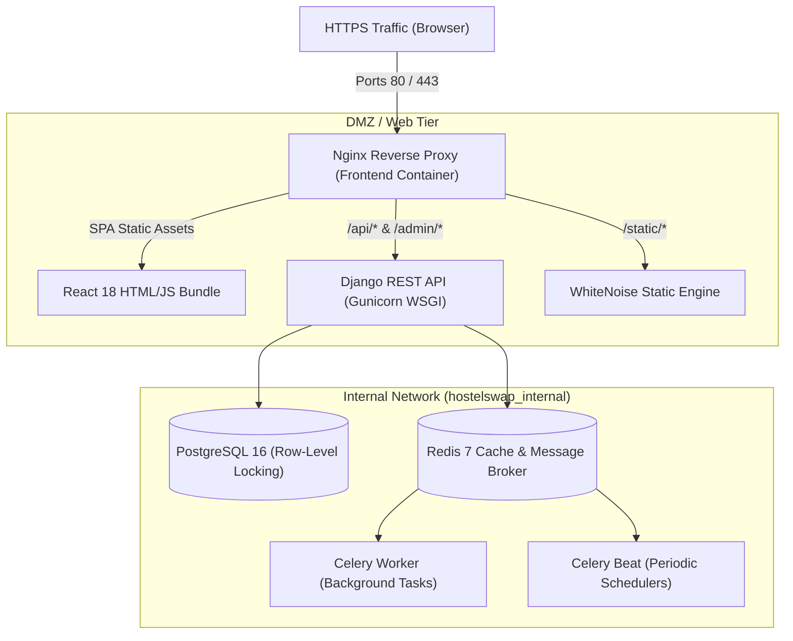

# Production Deployment Guide: HostelSwap

This guide provides end-to-end instructions for deploying **HostelSwap (Hostel Room Exchange and Multi-Party Swap Platform)** into a secure, production-grade cloud or on-premise environment.

---

## 1. Production Architecture Overview

In production, the application is decoupled into containerized microservices:



---

## 2. Deployment Options

| Method | Best For | Prerequisites |
| :--- | :--- | :--- |
| **Option A: Docker Compose** | Dedicated Linux VPS, AWS EC2, DigitalOcean, Hetzner | Docker 24+, Docker Compose v2 |
| **Option B: Render.com** | Zero-maintenance cloud hosting with auto-SSL | GitHub Account, Render Account |
| **Option C: Railway / Fly.io** | PaaS containers with ephemeral or managed DB | Railway CLI or Web Console |

---

## 3. Option A: Deployment with Docker Compose (Recommended for VPS)

### Step 1: Provision Server & Install Docker
Provision an Ubuntu 22.04 or 24.04 LTS instance with minimum **2 CPU cores** and **4 GB RAM**.

```bash
# Update system
sudo apt update && sudo apt upgrade -y

# Install Docker & Docker Compose
curl -fsSL https://get.docker.com | sh
sudo usermod -aG docker $USER
newgrp docker

# Verify Docker
docker --version
docker compose version
```

### Step 2: Clone the Clean Repository
```bash
git clone https://github.com/kkundantech/Hostel-Room-Swap.git /opt/hostelswap
cd /opt/hostelswap
```

### Step 3: Configure Production Environment Variables
```bash
cp .env.production.example .env

# Generate a high-entropy 50-character SECRET_KEY:
python3 -c "import secrets; print(secrets.token_urlsafe(50))"
```

Edit `.env` using your preferred editor (`nano .env`):
* Set `DJANGO_SECRET_KEY=<your_generated_secret_key>`.
* Set `DJANGO_DEBUG=False`.
* Set `DJANGO_ALLOWED_HOSTS=hostelswap.youruniversity.edu,your_server_ip`.
* Set `CORS_ALLOWED_ORIGINS=https://hostelswap.youruniversity.edu`.
* Set `CSRF_TRUSTED_ORIGINS=https://hostelswap.youruniversity.edu`.
* Set `DATABASE_PASSWORD=<strong_random_db_password>`.
* Configure SMTP email credentials for real-time OTP delivery.

### Step 4: Launch the Production Stack
```bash
# Build images and start all containers in detached mode
docker compose -f docker-compose.prod.yml up -d --build
```

Verify service status:
```bash
docker compose -f docker-compose.prod.yml ps
```

### Step 5: Initialize Master Administrator Account
```bash
docker compose -f docker-compose.prod.yml exec backend python manage.py createsuperuser
```
Follow the interactive prompts to set your primary administrative email and strong password.

---

## 4. Option B: 1-Click Deployment on Render.com

The repository includes a ready-to-use [`render.yaml`](file:///c:/Users/kunda/OneDrive/Desktop/Room%20Exchange/render.yaml) blueprint specification:

1. Log into your [Render Dashboard](https://dashboard.render.com/).
2. Click **Blueprints** -> **New Blueprint Instance**.
3. Connect your GitHub repository (`https://github.com/kkundantech/Hostel-Room-Swap`).
4. Render will automatically read `render.yaml` and provision:
   * **Managed PostgreSQL Database** (`hostelswap-db`)
   * **Managed Redis Service** (`hostelswap-redis`)
   * **Django REST API Web Service** (`hostelswap-backend`)
   * **Celery Background Worker** (`hostelswap-celery-worker`)
   * **React Static Frontend** (`hostelswap-frontend`)
5. Once deployed, open the Render backend shell and create your administrator:
   ```bash
   python backend/manage.py createsuperuser
   ```

---

## 5. Option C: Deployment on Railway / Heroku

The project includes a root [`backend/Procfile`](file:///c:/Users/kunda/OneDrive/Desktop/Room%20Exchange/backend/Procfile) for PaaS platforms:

```text
web: gunicorn config.wsgi:application --bind 0.0.0.0:$PORT --workers 3 --timeout 120
worker: celery -A config worker -l info --concurrency=3
beat: celery -A config beat -l info --scheduler django_celery_beat.schedulers:DatabaseScheduler
```

When provisioning PostgreSQL and Redis plugins on Railway, the platform provides `DATABASE_URL` and `REDIS_URL`. HostelSwap's [`settings.py`](file:///c:/Users/kunda/OneDrive/Desktop/Room%20Exchange/backend/config/settings.py) automatically parses `DATABASE_URL` with zero configuration needed.

---

## 6. SSL / HTTPS Configuration (Let's Encrypt)

If hosting on a Linux VPS with Docker Compose, terminate SSL with Certbot:

```bash
# Install Certbot
sudo apt install certbot python3-certbot-nginx -y

# Obtain SSL Certificate
sudo certbot certonly --standalone -d hostelswap.youruniversity.edu
```

Mount the generated certificates into the frontend container or use an outer host Nginx reverse proxy pointing to `127.0.0.1:80`.

---

## 7. Post-Deployment Verification & Health Checks

Once deployed, verify that the health check endpoints respond with HTTP 200:

```bash
# 1. API & Database Connectivity Probe
curl -f https://hostelswap.youruniversity.edu/api/health/
# Expected Response:
# {"status": "ok", "database": "ok", "version": "1.0.0"}

# 2. Frontend Nginx Health Probe
curl -f https://hostelswap.youruniversity.edu/healthz
# Expected Response:
# healthy
```

---

## 8. Backup & Maintenance Runbook

### Routine Database Backups
Create automated daily snapshots using `pg_dump`:

```bash
# Backup command
docker compose -f docker-compose.prod.yml exec -T db pg_dump -U postgres hostel_exchange_prod > /backup/hostelswap_$(date +%F).sql

# Restore command
cat /backup/hostelswap_YYYY-MM-DD.sql | docker compose -f docker-compose.prod.yml exec -T db psql -U postgres hostel_exchange_prod
```

### Log Inspection
```bash
# Follow backend logs
docker compose -f docker-compose.prod.yml logs -f backend

# Follow Celery worker logs
docker compose -f docker-compose.prod.yml logs -f celery_worker
```
