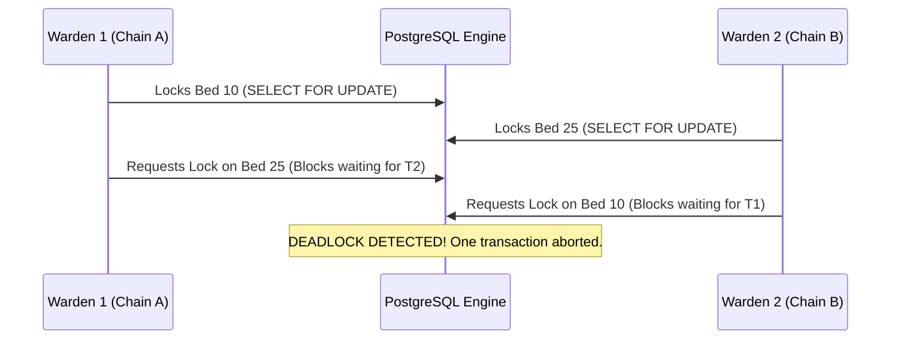
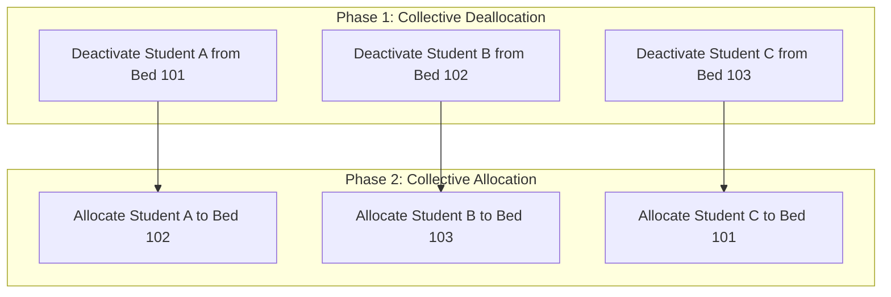

# Formal Architectural Note: Row-Level Locking Strategy & Concurrency Correctness (P04)

## 1. Executive Summary & Problem Definition

In a multi-party hostel room exchange system, room swaps are non-trivial multi-entity state transitions. In a 3-way, 4-way, or 5-way rotation cycle:
$$\text{Student } A \rightarrow \text{Bed } B \rightarrow \text{Student } B \rightarrow \text{Bed } C \rightarrow \text{Student } C \rightarrow \text{Bed } A$$

Executing this rotation requires mutating $N$ distinct occupancy allocations across $N$ physical beds simultaneously.

If two wardens simultaneously approve two proposals involving overlapping students or beds, or if an approval executes concurrently with an administrative deallocation, the system risks two catastrophic failure modes:
1. **Lost Updates & Duplicate Allocations**: Two students assigned to the exact same bed at the same time.
2. **Distributed Deadlocks**: Transaction $T_1$ acquires lock on Bed 1 and waits for Bed 2, while Transaction $T_2$ acquires lock on Bed 2 and waits for Bed 1.

This document details the PostgreSQL locking strategy implemented in HostelSwap (`apps/approvals/services.py`) and proves why it is mathematically deadlock-free and transactionally atomic.

---

## 2. Invariant Guarantee: Canonical Lock Ordering

### The Deadlock Hazard
A deadlock occurs when two concurrent transactions attempt to acquire shared locks in contradictory sequences:


### The Solution: Ascending Primary Key Ordering
To eliminate lock inversion deadlocks, all allocation and bed records must be acquired in a strictly monotonic global ordering. In relational databases, the primary key (`pk` or `id`) provides a total ordering over all rows.

In `apps/approvals/services.py`:
```python
# Lock all allocations in ascending PK order to guarantee deadlock-free execution:
current_allocations = list(
    Allocation.objects.select_for_update().filter(
        student_id__in=student_ids, is_active=True
    ).order_by('pk')  # <--- Strict canonical sort order
)
```

**Proof of Deadlock Freedom**:
Let $\mathcal{A}$ be the set of active allocations. Define the strict total order relation $<$ on $\mathcal{A}$ where $a_i < a_j \iff a_i.\text{pk} < a_j.\text{pk}$.
Because every transaction $T$ acquires locks in strictly ascending order according to $<$, the lock wait-for graph cannot contain a directed cycle. A directed cycle $T_1 \rightarrow T_2 \rightarrow \dots \rightarrow T_k \rightarrow T_1$ requires:
$$\text{pk}_{T_1} < \text{pk}_{T_2} < \dots < \text{pk}_{T_k} < \text{pk}_{T_1}$$
which is a contradiction since $<$ is a strict partial order. Therefore, **deadlocks are mathematically impossible**.

---

## 3. Proposal Idempotency & Concurrency Isolation

Before locking allocations, the proposal record itself must be locked to prevent concurrent double-execution by different wardens:

```python
with transaction.atomic():
    # Step 1: Lock proposal row with nowait=True
    proposal = ExchangeProposal.objects.select_for_update(nowait=True).get(id=proposal_id)
    
    # Step 2: Validate current status inside lock
    if proposal.status != ExchangeProposal.Status.PENDING_APPROVAL:
        raise ValueError(f"Proposal is not awaiting approval (status: {proposal.status}).")
```

- `nowait=True` ensures that if another warden is currently executing this proposal, the second thread fails fast immediately with a clear user message rather than hanging indefinitely.
- The status check inside the locked block guarantees that even if a second thread runs after the first commits, it finds `proposal.status == COMPLETED` and safely aborts.

---

## 4. Two-Phase Occupancy Reallocation

In relational schemas with uniqueness constraints on active beds (e.g., `UniqueConstraint(fields=['bed'], condition=Q(is_active=True))`):
Directly switching Bed 1 to Bed 2 can cause transient constraint collisions if done sequentially.

To solve this, HostelSwap executes a **Two-Phase Occupancy Reallocation**:



1. **Phase 1 (Collective Deallocation)**:
   All participants' existing allocations are marked `is_active=False` and timestamped with `deallocated_at`. At the end of Phase 1, all beds in the cycle are temporarily unoccupied.
2. **Phase 2 (Collective Allocation)**:
   New `Allocation` records are created for each student with their target bed (`is_active=True`).
   Corresponding `TransferRecord` entries and `AuditEntry` logs are generated simultaneously.

All operations execute inside a single atomic block (`transaction.atomic()`). If any failure occurs during Phase 2, the entire transaction rolls back cleanly, leaving all original allocations 100% untouched.

---

## 5. Non-Blocking Notification Dispatch

Post-commit actions (such as sending emails or webhooks) are **never executed inside the database transaction**:
```python
# Dispatched only after the transaction commits successfully:
transaction.on_commit(_send_post_commit_notifications)
```
This guarantees:
1. Long-running SMTP handshakes never hold PostgreSQL row locks open.
2. No emails are ever dispatched for transactions that rolled back due to error.
