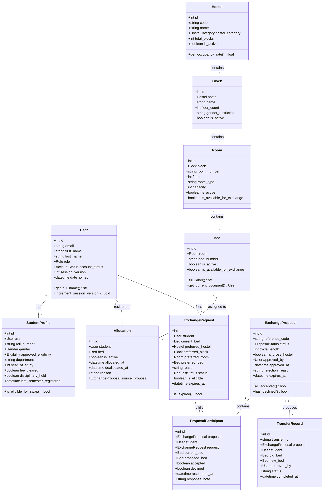
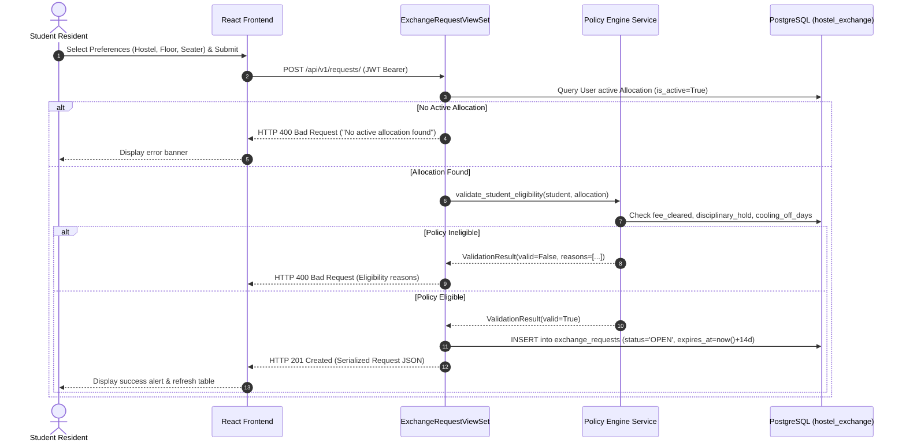
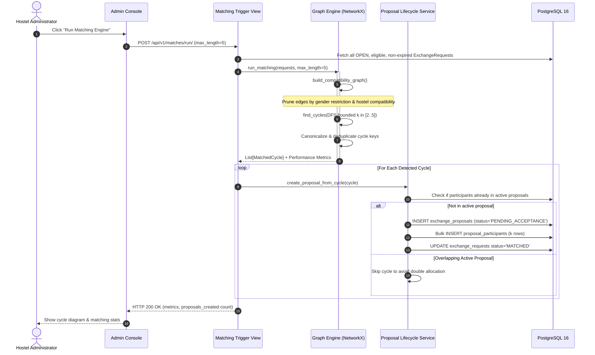
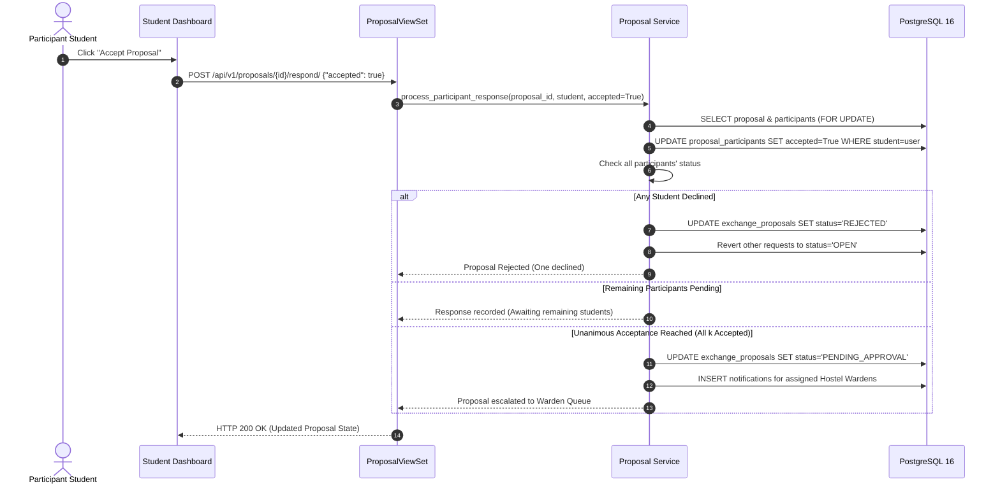
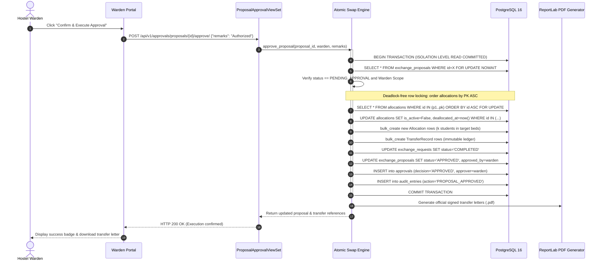

# Low-Level Design (LLD) Document

**System:** Hostel Room Exchange & Multi-Party Swap Platform  
**Target:** Lovely Professional University (LPU)  
**Backend:** Django 5.2 / DRF 3.15 / PostgreSQL 16 (Port 5433)  
**Frontend:** React 18 / Vite 5 / Tailwind CSS v3.4  
**Date:** November 2026

---

## 1. Class & Object-Oriented Design



---

## 2. Sequence Diagrams for Core Workflows

### 2.1 Sequence 1: Exchange Request Creation & Policy Verification



---

### 2.2 Sequence 2: Graph Matching & Cycle Discovery



---

### 2.3 Sequence 3: Student Consent & Consensus Aggregation



---

### 2.4 Sequence 4: Warden Review & Atomic Room Swap Execution



---

## 3. Database Constraints & Data Dictionary

| Table Name | Column | Data Type | Constraints | Business Invariant |
|---|---|---|---|---|
| `accounts_user` | `id` | `BIGSERIAL` | `PRIMARY KEY` | Unique account entity |
| `accounts_user` | `email` | `VARCHAR(254)` | `UNIQUE, NOT NULL` | Universal login identifier |
| `accounts_user` | `role` | `VARCHAR(20)` | `NOT NULL, CHECK (role IN (...))` | Strict RBAC role enumeration |
| `accounts_user` | `session_version` | `INTEGER` | `NOT NULL, DEFAULT 1` | Instant revocation tracking |
| `accounts_user` | `account_status` | `VARCHAR(20)` | `NOT NULL, DEFAULT 'ACTIVE'` | `ACTIVE`, `SUSPENDED`, `REVOKED` |
| `hostels_hostel` | `code` | `VARCHAR(20)` | `UNIQUE, NOT NULL` | Short code (e.g., `BH1`, `GH1`) |
| `hostels_hostel` | `hostel_category` | `VARCHAR(10)` | `NOT NULL, CHECK (IN ('BOYS', 'GIRLS'))` | Prevents cross-gender setups |
| `hostels_bed` | `room_id` | `BIGINT` | `FOREIGN KEY -> hostels_room(id)` | Cascade delete on room removal |
| `hostels_bed` | `bed_number` | `VARCHAR(10)` | `NOT NULL` | Single letter identifier (A, B, C, D) |
| `hostels_bed` | `(room_id, bed_number)` | `COMPOSITE` | `UNIQUE CONSTRAINT` | No duplicate beds in the same room |
| `hostels_allocation` | `student_id` | `BIGINT` | `FOREIGN KEY -> accounts_user(id)` | Current resident reference |
| `hostels_allocation` | `bed_id` | `BIGINT` | `FOREIGN KEY -> hostels_bed(id)` | Target bed reference |
| `hostels_allocation` | `is_active` | `BOOLEAN` | `NOT NULL, DEFAULT TRUE` | True only while student resides |
| `exchange_requests_exchangerequest` | `status` | `VARCHAR(20)` | `CHECK (status IN ('OPEN','MATCHED','COMPLETED','CANCELLED','EXPIRED'))` | Request state machine |
| `proposals_exchangeproposal` | `reference_code`| `VARCHAR(32)` | `UNIQUE, NOT NULL` | Human-readable tracking `#PROP-...` |
| `proposals_exchangeproposal` | `status` | `VARCHAR(25)` | `CHECK (status IN ('PENDING_ACCEPTANCE', 'PENDING_APPROVAL', 'APPROVED', 'REJECTED', 'EXPIRED'))` | Proposal voting & review status |
| `transfers_transferrecord` | `transfer_id` | `VARCHAR(36)` | `UNIQUE, NOT NULL` | UUID tracking code for PDF verification |

---

## 4. Algorithmic Pseudo-Code

### 4.1 Directed Compatibility Graph Builder

```python
def build_compatibility_graph(requests: List[ExchangeRequest]) -> nx.DiGraph:
    G = nx.DiGraph()
    bed_to_request = {req.current_bed_id: req for req in requests}

    for req in requests:
        G.add_node(req.id, request=req)

    for req_a in requests:
        for req_b in requests:
            if req_a.id == req_b.id:
                continue

            # 1. Gender compatibility check (Invariant)
            if req_a.student.student_profile.gender != req_b.current_bed.room.block.hostel.hostel_category:
                continue

            # 2. Preference satisfaction check
            if not _preferences_compatible(req_a, req_b.current_bed):
                continue

            # 3. Bed availability check
            if not req_b.current_bed.is_available_for_exchange:
                continue

            # Directed edge A -> B: Student A desires the bed occupied by Student B
            G.add_edge(req_a.id, req_b.id)

    return G
```

### 4.2 Bounded DFS Simple Cycle Detection

```python
def find_cycles(G: nx.DiGraph, max_length: int = 5) -> List[MatchedCycle]:
    detected_cycles = []
    seen_canonical_keys = set()

    for node in G.nodes():
        # Start DFS rooted at 'node' up to max_length depth
        stack = [(node, [node])]
        while stack:
            current, path = stack.pop()
            for neighbor in G.successors(current):
                if neighbor == node and len(path) >= 2:
                    # Found a valid cycle returning to root
                    canonical_key = frozenset(path)
                    if canonical_key not in seen_canonical_keys:
                        seen_canonical_keys.add(canonical_key)
                        ordered_requests = [G.nodes[n]['request'] for n in path]
                        detected_cycles.append(MatchedCycle(requests=ordered_requests))
                elif neighbor not in path and len(path) < max_length:
                    stack.append((neighbor, path + [neighbor]))

    # Prioritize shorter, higher-consensus cycles first (length 2 then 3, etc.)
    return sorted(detected_cycles, key=lambda c: (c.cycle_length, c.requests[0].id))
```

---

## 5. API Interface Contracts & Response Envelopes

### 5.1 POST `/api/v1/auth/token/` (User Login)
- **Request Body:**
  ```json
  {
    "email": "student1@hostel.edu",
    "password": "Password@123"
  }
  ```
- **Response `200 OK`:**
  ```json
  {
    "access": "<JWT_ACCESS_TOKEN>",
    "refresh": "<JWT_REFRESH_TOKEN>",
    "user": {
      "id": 101,
      "email": "student1@hostel.edu",
      "first_name": "Arjun",
      "last_name": "Verma",
      "role": "STUDENT",
      "registration_number": "12108676"
    }
  }
  ```

### 5.2 POST `/api/v1/requests/` (Create Request)
- **Request Body:**
  ```json
  {
    "preferred_hostel": 1,
    "preferred_seater": "2 Seater",
    "preferred_floor": "3rd or 4th Floor",
    "reason": "Closer to robotics lab and research peers"
  }
  ```
- **Response `201 Created`:**
  ```json
  {
    "id": 42,
    "student": {
      "id": 101,
      "email": "student1@hostel.edu",
      "full_name": "Arjun Verma"
    },
    "current_bed_label": "BH1/A/Room-101/Bed-A",
    "preferred_hostel_name": "Boys Hostel 1 (BH1)",
    "status": "OPEN",
    "is_eligible": true,
    "days_remaining": 14,
    "created_at": "2026-11-13T10:00:00Z",
    "expires_at": "2026-11-27T10:00:00Z"
  }
  ```

### 5.3 POST `/api/v1/approvals/proposals/{id}/approve/` (Execute Swap)
- **Request Body:**
  ```json
  {
    "remarks": "Approved after inspecting participant eligibility clearances."
  }
  ```
- **Response `200 OK`:**
  ```json
  {
    "id": 12,
    "reference_code": "PROP-202611-0012",
    "status": "APPROVED",
    "cycle_length": 3,
    "is_cross_hostel": false,
    "approved_by": {
      "id": 5,
      "email": "warden.bh1@hostel.edu",
      "full_name": "Rajesh Kumar"
    },
    "executed_at": "2026-11-13T10:45:00Z",
    "acceptance_progress": {
      "total": 3,
      "accepted": 3,
      "declined": 0,
      "pending": 0
    }
  }
  ```

---

## 6. Concurrency Safety & Deadlock Prevention

When executing a multi-party rotation involving $k$ students ($u_1, u_2, \dots, u_k$), multiple wardens or automated tasks could theoretically trigger simultaneous approvals. To eliminate deadlocks:

1. **Strict Sort Ordering on Resource Locks:**  
   Before updating allocations, all targeted `Allocation` and `Bed` records are selected using `select_for_update()` ordered strictly by **Primary Key ascending**:
   ```python
   locked_allocations = list(
       Allocation.objects.select_for_update()
       .filter(id__in=allocation_ids)
       .order_by('id')
   )
   ```
2. **Elimination of Lock Inversion:**  
   Because every transaction acquires locks in the identical global ordering ($id_1 < id_2 < \dots < id_k$), circular wait conditions are mathematically impossible.
3. **Optimistic Pre-Validation:**  
   Prior to mutating rows, the engine re-checks that every student's currently active bed matches the proposal snapshot. If any allocation shifted between proposal creation and approval, the transaction raises a validation error and aborts immediately.

